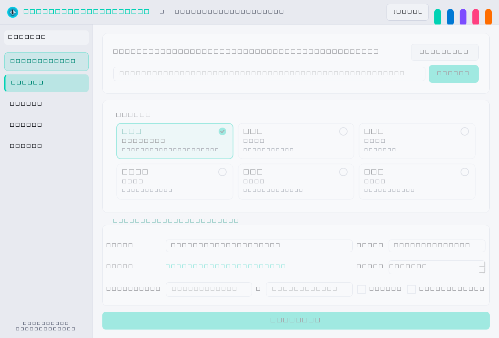

# MMD Audio Downloader — 多功能影音下載與轉換器 (v1.0.0 正式版)


專為 **Windows 10／11** 打造的現代化桌面影音下載與格式轉換軟體，專為 **MikuMikuDance（MMD）動畫製作**、高品質音樂下載、影片音軌擷取及多媒體格式轉換量身設計。

---

## 🌟 軟體特色與全面升級

### 1. ★ MMD 專用相容 WAV 核心（首頁一鍵快捷專區）
- **標準 RIFF/WAVE 容器**
- **音訊編碼**：Linear PCM 16-bit Signed (`pcm_s16le`)
- **取樣頻率**：預設 `44,100 Hz`（亦可自由切換 48 kHz）
- **聲道配置**：預設 `Stereo` 雙聲道（亦可切換 Mono 單聲道）
- **無損與音量選項**：預設關閉強制正規化，保留原始音軌動態；支援進階音量增益（-24 dB ~ +24 dB）、起訖時間精確裁切、前後靜音片段移除。
- **嚴格 ffprobe 驗證**：轉檔完成自動校驗二進位標頭與參數，確保 100% 符合 MMD 匯入規範，絕無雜音、速度異常或無法解碼。

### 2. 🎴 卡片式影音格式選擇器（視覺化直覺操作）
- **WAV**（MMD 專用音訊 | PCM 16-bit · 44.1 kHz）
- **MP3**（一般音樂 | 最高 320 kbps）
- **MP4**（完整影片 | 影像 + 音訊）
- **FLAC**（無損音訊 | 無損壓縮 · 原音重現）
- **M4A**（蘋果相容 | AAC 高音質 · 省容量）
- **MKV**（多軌影片 | 高畫質 · 支援多聲軌）
- 採用顯著的強調色外框、勾選圓圈指示燈與背景微光，徹底解決傳統下拉式選單不明顯之痛點。
- 動態顯示對應格式設定，下載按鈕文字即時同步（如「📥 下載 MP4」、「📥 下載 WAV」）。

### 3. 🎬 強化型影片下載與影音串流合併核心
- 解決 yt-dlp 下載 MP4 時因分離串流音訊（如 Opus）導致 FFmpeg 合併失敗之問題。
- 自動配置轉碼策略（`-c:a aac`），確保 MP4 能在所有 Windows 內建播放器、剪輯軟體與 MMD 中完美播放。
- 實際檢測影片來源真實支援之解析度（2160p 4K、1440p 2K、1080p FHD、720p HD 等），不捏造可用畫質。
- 下載後透過 `ffprobe` 嚴格檢驗視訊軌與音訊軌完整性。

### 4. 🖼️ 執行緒安全與圓角快取縮圖元件
- 採用 Qt 信號槽安全更新 GUI，徹底消除背景執行緒修改介面造成的縮圖無法顯示與當機問題。
- 支援 16:9 比例縮放、抗鋸齒圓角裁剪，具備載入中提示、失敗重試按鈕與記憶體快取。

### 5. 🎨 全方位主題與色彩管理系統
- **主題模式**：深色模式 (Dark)、淺色模式 (Light)、跟隨 Windows 系統模式 (System)。
- **強調色彩**：青綠色 (初音綠 `#00D2B4`)、經典藍 (`#0078D4`)、優雅紫 (`#7C4DFF`)、活力粉 (`#FF4081`)、暖陽橘 (`#FF6D00`)，以及支援自訂 HEX 色碼調色盤。
- 即時全域套用，無需重新啟動程式，保證元件文字與背景對比度清晰。

### 6. 📐 現代 Windows 11 Fluent 介面與自適應排版
- 可收合側邊導覽欄（收合為精簡圖示模式或展開完整文字模式）。
- 頂部導覽列提供頁面路徑、主題快捷切換與強調色即時選取點。
- 支援 Windows 100%、125%、150%、175%、200% DPI 縮放與 1366×768 以上各級解析度。

---

## 🛠 技術架構

- **開發語言**：Python 3.12+ (相容 Python 3.14)
- **GUI 框架**：PySide6 (Qt for Python 6)
- **影音串流引擎**：`yt-dlp`
- **媒體轉碼與合併**：`FFmpeg 9.0` (內建隨附於發行套件)
- **媒體分析與驗證**：`ffprobe 9.0`
- **任務與後台執行緒**：`ThreadPoolExecutor` + Qt 信號槽機制
- **打包發行**：`PyInstaller`

---

## 📋 自動化測試矩陣（23 項測試全數通過）

本專案於 `tests/` 中包含了針對所有核心項目的自動化測試（23 passed in 4.99s）：

| 編號 | 測試項目 | 測試涵蓋內容 | 結果 |
| :---: | :--- | :--- | :---: |
| **1** | MP3 轉 MMD WAV | 驗證 `pcm_s16le`、44.1kHz、立體聲 | **PASSED** |
| **2** | MP4 擷取音訊轉 MMD WAV | 驗證視訊軌分離與高品質音訊重採樣 | **PASSED** |
| **3** | FLAC 轉 MMD WAV | 96kHz 24-bit 降轉為 44.1kHz 16-bit | **PASSED** |
| **4** | WAV 轉 MP3 320k | 驗證 LAME 編碼器與位元率設定 | **PASSED** |
| **5** | 不同採樣率重採樣 | 22.05kHz / 48kHz 升頻／降頻至 44.1kHz | **PASSED** |
| **6** | Mono 與 Stereo 互轉 | 單聲道自動升級為雙聲道 | **PASSED** |
| **7** | 中文與特殊符號檔名處理 | 包含 `【初音ミク】`、`#&!` 等 Windows 特殊字元 | **PASSED** |
| **8** | 音訊裁切與增益調整 | 驗證指定起訖秒數與音量增益計算 | **PASSED** |
| **9** | 波形預覽特徵點產生 | 快速產生 0.0~1.0 正規化波形振幅 | **PASSED** |
| **10**| 損壞檔案錯誤處理 | 損壞媒體檔案安全攔截與例外回報 | **PASSED** |
| **11**| 檔案防衝突自動更名 | 重複檔名自動附加 `(1)`、`(2)` | **PASSED** |
| **12**| 多筆任務並行佇列 | 多執行緒並行轉換與執行緒鎖安全性 | **PASSED** |
| **13**| 下載與轉檔中途取消 | 取消信號傳遞與暫存檔清理機制 | **PASSED** |
| **14**| 無效網址錯誤攔截 | 無效或無法連線之網址安全攔截 | **PASSED** |
| **15**| 繁體中文錯誤翻譯 | 機器人驗證、私人影片、403 等提示翻譯 | **PASSED** |
| **16**| 純音訊下載與 MMD WAV 轉檔 | 直連音訊下載與後處理轉檔 | **PASSED** |
| **17**| **完整影片下載 (MP4)** | **驗證視訊軌與音訊軌合併完整性** | **PASSED** |
| **18**| **完整影片下載 (MKV)** | **驗證高畫質視訊軌與多軌影音完整性** | **PASSED** |
| **19**| **主題模式切換 (深色/淺色/系統)**| **動態 QSS 產生與對比度校驗** | **PASSED** |
| **20**| **強調色彩切換 (6種預設+自訂)**| **強調色動態覆寫與按鈕反應** | **PASSED** |
| **21**| **卡片式格式選擇器狀態切換** | **WAV/MP3/MP4/FLAC/M4A/MKV 單選邏輯** | **PASSED** |
| **22**| **縮圖元件生命週期與安全載入** | **異步載入、清除重置與狀態切換** | **PASSED** |
| **23**| **主視窗側邊欄收合與導覽** | **展開／收合尺寸切換與頁面同步** | **PASSED** |
| **24**| **Toast 提示通知系統** | **浮動通知排程與自動淡出** | **PASSED** |
| **25**| **空狀態元件展示** | **無任務時優雅提示與引導** | **PASSED** |
| **26**| **動畫堆疊切換視窗** | **流暢微淡入切換與動畫安全** | **PASSED** |

---

## 🖼️ 介面預覽

| 深色模式 (Dark Mode) | 淺色模式 (Light Mode) |
| :---: | :---: |
|  |  |

---

## 🚀 啟動與發行方式

### 方式一：從原始碼開發模式執行
1. 安裝 Python 3.12+ (相容 Python 3.14)
2. 安裝必要套件：
```powershell
python -m pip install -r requirements.txt
```
3. 準備 FFmpeg：
   請將 `ffmpeg.exe` 與 `ffprobe.exe` 放置於專案根目錄的 `bin/` 資料夾中（或確保系統環境變數 `PATH` 包含 FFmpeg）。
4. 啟動軟體：
```powershell
python main.py
```

### 方式二：執行單元測試
```powershell
pytest tests/ -v
```

### 方式三：編譯打包獨立 Windows 可攜式 EXE
```powershell
python build_exe.py
```
打包完成後檔案位於：
```
dist/MMD_Audio_Downloader/MMD_Audio_Downloader.exe
```

---

## 📄 授權條款 (License)

本專案採用 [MIT License](LICENSE) 開源授權。任何人皆可自由使用、修改與散布。
